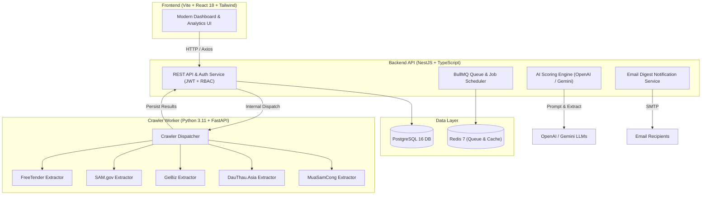

# TenderScope — AI-Powered Tender Intelligence & Ranking Platform

<p align="center">
  
</p>

<p align="center">
  <strong>Hệ thống tự động thu thập thông tin thầu đa nguồn và chấm điểm, thẩm định năng lực trúng thầu thông minh bằng AI.</strong>
</p>

<p align="center">
  
  
  
  
  
  
  
</p>

---

## 🌟 Tổng Quan Dự Án (Overview)

**TenderScope** là nền tảng mã nguồn mở toàn diện giúp doanh nghiệp, nhà thầu và các tổ chức công nghệ chủ động theo dõi, phân tích và săn tìm các gói thầu tiềm năng. Thay vì phải tra cứu thủ công hàng ngày trên hàng chục cổng đấu thầu khác nhau, hệ thống tự động:

1. **Thu thập (Crawler)**: Tự động crawl gói thầu mở và kết quả đấu thầu đã đóng từ các cổng trong nước và quốc tế.
2. **Đối sánh tiêu chí (Criteria Matching)**: Lưu trữ hồ sơ năng lực công ty và bộ tiêu chuẩn ngành nghề, công nghệ, chứng chỉ.
3. **Thẩm định & Chấm điểm bằng AI**: Phân tích hồ sơ mời thầu (E-HSMT, mô tả, yêu cầu kỹ thuật) đối chiếu với năng lực thực tế bằng các mô hình LLM tiên tiến (OpenAI GPT-4o, Google Gemini) đưa ra khuyến nghị: `GO`, `CONSIDER` hoặc `NO_GO`.
4. **Phân tích đối thủ (Competitor Intelligence)**: Theo dõi lịch sử trúng thầu, giá trúng thầu và phân tích SWOT điểm mạnh/yếu của các đối thủ cạnh tranh trên thị trường.
5. **Thông báo qua Email (Email Digest)**: Gửi bản tin tóm tắt các gói thầu điểm cao nhất mỗi buổi sáng tới đội ngũ phát triển kinh doanh (BD).

---

## 🌐 Các Nguồn Dữ Liệu Hỗ Trợ (Supported Portals)

| Cổng Đấu Thầu | Thị trường | Mô tả |
| :--- | :--- | :--- |
| **Mua Sắm Công** (`muasamcong_keyword`) | Việt Nam | Hệ thống mạng đấu thầu quốc gia chính thức (muasamcong.mpi.gov.vn) |
| **DauThau.Asia** (`dauthauasia_keyword`) | Việt Nam | Cổng tổng hợp thông tin đấu thầu và hồ sơ mời thầu |
| **BidWinner** (`bidwinner_keyword`) | Việt Nam | Cổng theo dõi tiến độ và cơ hội thầu |
| **FreeTender** (`freetender_keyword`) | Quốc tế / VN | Dữ liệu đấu thầu mở |
| **GeBiz** (`gebiz_keyword`) | Singapore | Cổng đấu thầu chính phủ Singapore (gebiz.gov.sg) |
| **SAM.gov** (`samgov_keyword`) | Hoa Kỳ (US) | Cổng thông tin cơ hội hợp đồng liên bang chính phủ Mỹ |

---

## 🏗️ Kiến Trúc Hệ Thống (Architecture)



---

## 📦 Cấu Trúc Mã Nguồn (Monorepo Layout)

```
tender-ranking-system/
├── apps/
│   ├── backend/               # NestJS REST API, Prisma ORM, BullMQ scheduler
│   │   ├── prisma/            # Schema database & squashed migrations
│   │   └── src/
│   │       ├── auth/          # Authentication & user authorization
│   │       ├── crawler/       # Trigger & sync crawling jobs
│   │       ├── scoring/       # AI evaluation logic & prompt templates
│   │       ├── mailer/        # SMTP email digest service
│   │       └── ...
│   ├── frontend/              # Single Page Application (React, Vite, shadcn/ui)
│   │   └── src/
│   │       ├── assets/        # Logo SVG, Favicon
│   │       ├── components/    # Reusable UI & custom data tables
│   │       ├── layout/        # Responsive AppLayout with sidebar
│   │       └── pages/         # Tenders, Closed Tenders, Sources, Stats, Settings
│   └── crawler-worker/        # Python FastAPI worker for multi-portal web scrapers
│       └── app/
│           ├── muasamcong/    # Vietnam e-GP scraper
│           ├── dauthauasia/   # DauThau.Asia scraper
│           ├── gebiz/         # Singapore GeBiz scraper
│           ├── samgov/        # US SAM.gov scraper
│           └── ...
├── docker-compose.yml         # Full multi-container stack deployment
├── docker-compose.dev.yml     # Local database & redis support for development
├── .env.example               # Clean configuration template
└── README.md
```

---

## 🚀 Hướng Dẫn Cài Đặt & Khởi Chạy (Quick Start)

### 1. Yêu cầu môi trường (Prerequisites)
- [Docker](https://docs.docker.com/get-docker/) & Docker Compose (Khuyên dùng)
- Hoặc cài đặt thủ công: Node.js 20+, Python 3.11+, PostgreSQL 16, Redis 7.

### 2. Thiết lập Biến Môi Trường (Environment Setup)
Sao chép file cấu hình mẫu:
```bash
cp .env.example .env
```
Mở file `.env` và điền các giá trị cần thiết (như OpenAI / Gemini API Key, thông tin Database).

### 3. Chạy toàn bộ hệ thống bằng Docker Compose (Khuyên dùng)
```bash
# Build và khởi chạy tất cả services
docker compose up -d --build
```
Sau khi khởi động thành công:
- **Giao diện người dùng (Frontend)**: `http://localhost:8080`
- **Backend API**: `http://localhost:3000`
- **Tài liệu API Swagger**: `http://localhost:3000/api`
- **Crawler Worker Service**: `http://localhost:8000/docs`

Tài khoản quản trị mặc định (được khởi tạo tự động):
- **Email**: `admin@example.com`
- **Mật khẩu**: `change_me_admin_password` *(có thể cấu hình trong `.env`)*

---

### 4. Chạy thủ công cho mục đích phát triển (Local Development)

#### Khởi chạy Database & Redis:
```bash
docker compose -f docker-compose.dev.yml up -d
```

#### Khởi chạy Backend:
```bash
cd apps/backend
npm install
npx prisma migrate dev
npm run start:dev
```

#### Khởi chạy Frontend:
```bash
cd apps/frontend
npm install
npm run dev
```

#### Khởi chạy Crawler Worker:
```bash
cd apps/crawler-worker
python -m venv .venv
# Trên Windows: .venv\Scripts\activate | Trên Linux/macOS: source .venv/bin/activate
pip install -r requirements.txt
uvicorn app.main:app --host 0.0.0.0 --port 8000 --reload
```

---

## 🔑 Cấu Hình AI Providers (OpenAI & Gemini)

Hệ thống hỗ trợ linh hoạt cả **OpenAI** và **Google Gemini**:
- **OpenAI**: Đặt `OPENAI_API_KEY=sk-...` và cấu hình model `OPENAI_MODEL=gpt-4o-mini` trong `.env`.
- **Google Gemini**: Hỗ trợ endpoint tương thích OpenAI hoặc API trực tiếp thông qua cấu hình `OPENAI_BASE_URL`.

---

## 🛡️ Giấy Phép (License)

Dự án được phân phối dưới giấy phép **[MIT License](LICENSE)**. Bạn hoàn toàn có quyền sử dụng, sửa đổi và triển khai cho mục đích cá nhân lẫn thương mại.
